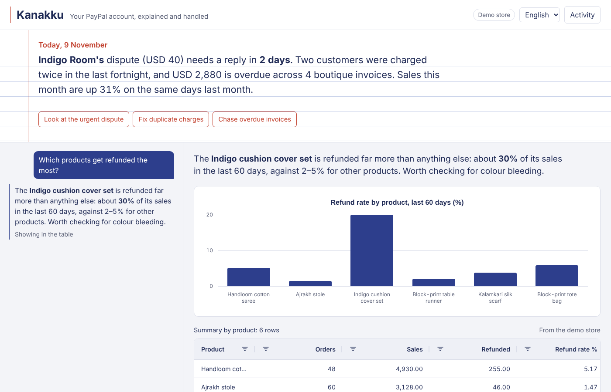
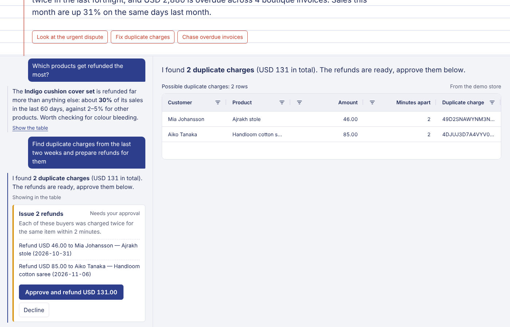

# Kanakku

**Ask your PayPal account a question in any language, and get the answer as a live table and chart. Then let it chase invoices, refund duplicate charges and send new invoices, each one only after you approve it.**

*Kanakku* (கணக்கு) is Tamil for "accounts", after the cloth-bound notebook small shops keep their books in.

Built for the [PayPal AI Hackathon](https://paypalaihackathon.devpost.com/).



## The problem

Small online sellers and freelancers get paid through PayPal, but their account shows long lists, not answers. Questions like "which product gets refunded most?" or "who still owes me money?" mean exporting a CSV and working it out in a spreadsheet, so most sellers don't. Things slip through: duplicate charges annoy customers, overdue invoices go unchased, and dispute deadlines pass, which usually means losing the money. Many of these sellers (in India and elsewhere) are also more comfortable in their own language than in English dashboards.

## What it does

- **Morning brief.** When you open Kanakku, it tells you what needs attention, most urgent first: disputes close to their deadline, possible duplicate charges, overdue invoices, and how sales compare with the same days last month. The numbers are computed exactly in code; Claude only writes the sentences.
- **Ask anything.** Questions in English, Tamil, Hindi or a mix ("indha maasam evlo sales?") come back in the same language, with a sortable, filterable **AG Grid** table and an **AG Charts** chart built from the real rows.
- **Act with approval.** "Refund the duplicate charges" or "remind everyone who's overdue" produces a confirmation card listing every step and the total money out. Nothing happens until you press Approve.
- **Activity log.** Every approved or declined action is recorded with the question that led to it.



## How it works

```
React + AG Grid + AG Charts  ──►  Express API  ──►  Claude (tool use)
                                        │                 │
                                        │        tools: search_transactions, summarize_transactions,
                                        │        find_duplicate_charges, list_invoices, list_disputes,
                                        │        propose_refunds, propose_invoice_reminders,
                                        │        propose_new_invoice, present_answer
                                        ▼
                               PayPal REST APIs (sandbox)
            Transaction Search · Invoicing v2 · Disputes · Payments v2 refunds · Orders v2
```

Three design choices keep it trustworthy:

1. **The grid never shows numbers Claude typed.** Read tools save their results as datasets on the server. Claude answers by pointing at a dataset id (`present_answer`), and the server sends the real rows to the grid. Totals and refund rates come from `summarize_transactions`, not from model arithmetic.
2. **Claude can't move money.** The `propose_*` tools only create a pending action, after checking that the payment or invoice really exists and hasn't already been refunded or paid. The refund, reminder or invoice runs only when the seller presses Approve, and an action can't be approved twice.
3. **Invented ids are rejected.** If Claude names a transaction it hasn't looked up, the tool returns an error instead of creating an action.

### PayPal APIs used

| What | Endpoint |
| --- | --- |
| Sales, refunds, fees, payouts | `GET /v1/reporting/transactions` (Transaction Search) |
| Invoices | `GET /v2/invoicing/invoices` |
| Payment reminders | `POST /v2/invoicing/invoices/{id}/remind` |
| New invoices | `POST /v2/invoicing/invoices` and `.../{id}/send` |
| Disputes | `GET /v1/customer/disputes` |
| Refunds | `POST /v2/payments/captures/{id}/refund` |
| Seed payments | `POST /v2/checkout/orders` (card, sandbox only) |

### AI used

[Claude](https://docs.claude.com) through the Anthropic Messages API with tool use (default model `claude-sonnet-5-5`, configurable). Claude decides which PayPal tools to call, combines the results, chooses the table columns and chart, writes the brief, and replies in the seller's language.

## Run it

Requires Node.js 20 or newer.

```bash
git clone <this repo>
cd kanakku
npm install
cp .env.example .env      # then add your keys (see below)
npm run build             # builds the web app
npm start                 # serves app + API at http://localhost:8787
```

For development with hot reload, run `npm run dev` and open http://localhost:5173.

### Keys

| Variable | Where to get it |
| --- | --- |
| `ANTHROPIC_API_KEY` | https://console.anthropic.com/ |
| `PAYPAL_CLIENT_ID`, `PAYPAL_CLIENT_SECRET` | https://developer.paypal.com → Apps & Credentials → Sandbox |

### Data modes

- **No PayPal keys:** Kanakku runs on a built-in demo store, *Meena Prints*, a hand-block-printing studio in Coimbatore selling to customers abroad. It has four months of realistic sales, an Indigo cushion cover set with a refund problem, two duplicate charges, overdue boutique invoices and an urgent dispute. Refunds, reminders and invoices you approve really change the demo store, and "Reset demo store" in the Activity panel restores it.
- **With PayPal sandbox keys:** Kanakku reads and acts on your sandbox account. Run `npm run seed` once to create boutique invoices and, if you set `SEED_TEST_CARD_NUMBER` to a [sandbox test card](https://developer.paypal.com/tools/sandbox/card-testing/), captured payments including a duplicate charge. New sandbox payments can take a few hours to appear in Transaction Search; invoices appear right away.
- Force either with `DATA_MODE=demo` or `DATA_MODE=live`.

### Tests

```bash
npm test
```

The tests use a scripted stand-in for Claude to check the important guarantees: the grid shows real dataset rows, unknown columns are dropped, refunds wait for approval and run exactly once, already-refunded payments and invented ids are refused, and declined actions never run.

## Project layout

```
server/
  src/agent/      Claude loop, tools, analytics (summaries, duplicates, brief facts), approval store
  src/data/       PayPal source, demo store, shared types
  src/paypal/     OAuth + REST client
  scripts/        sandbox seed script
  test/
web/
  src/            React app: brief, conversation, approval cards, AG Grid + AG Charts results
```

## License

[MIT](LICENSE)
