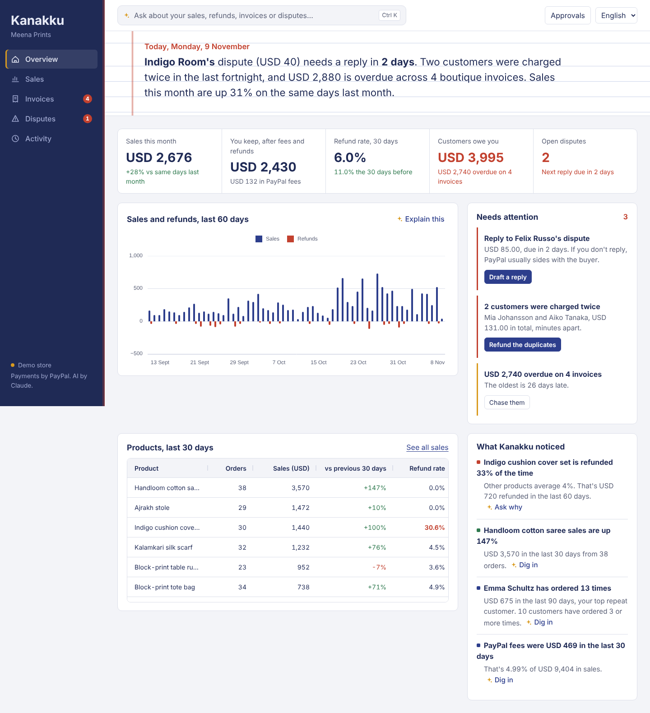
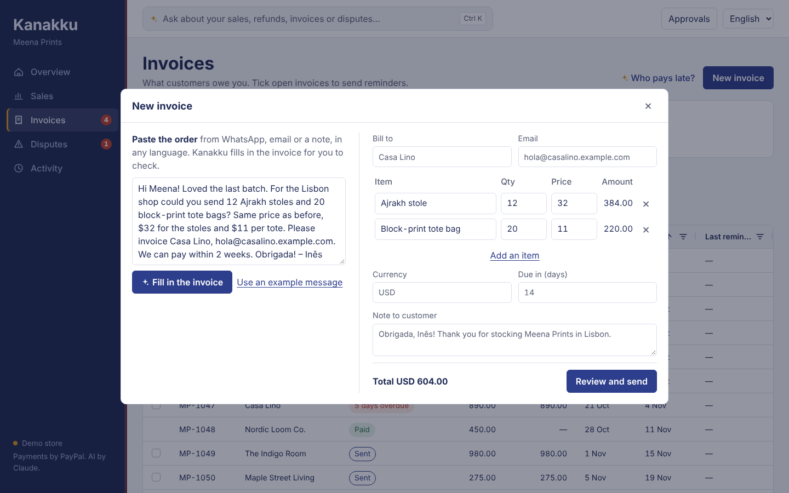
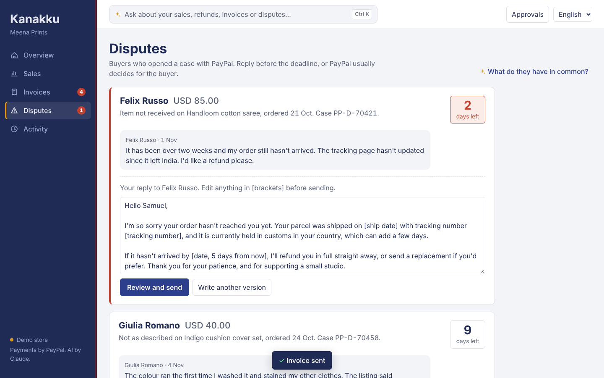
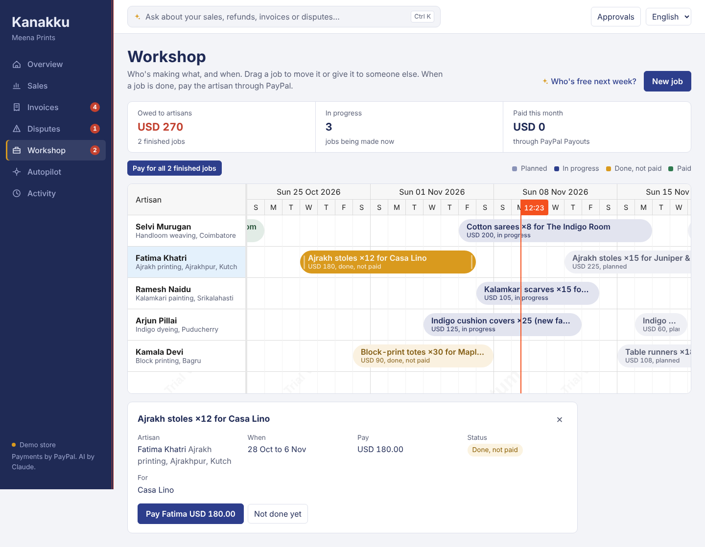
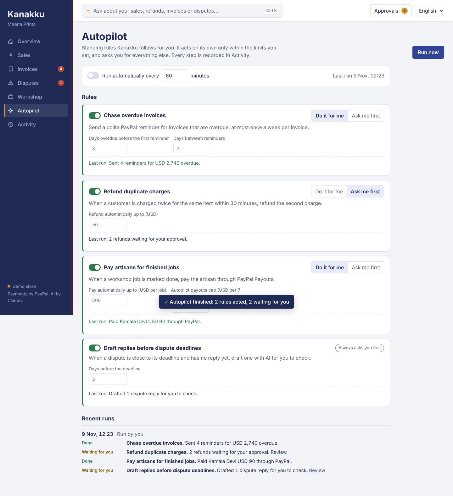
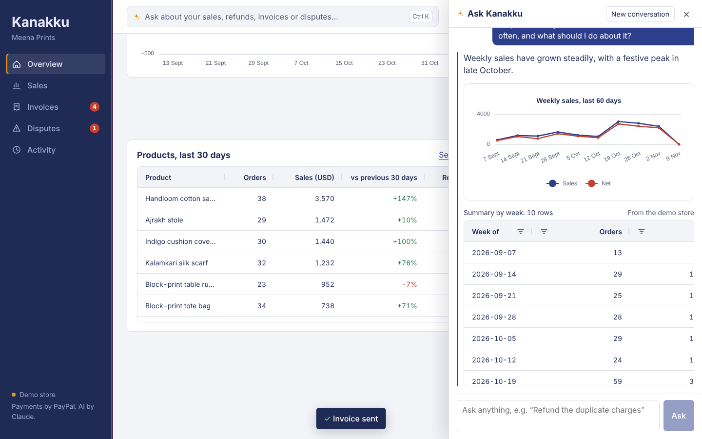

# Kanakku

**A PayPal back office for small online sellers, with AI built into every screen.** See what needs attention today, understand your sales, chase invoices, answer disputes, fix duplicate charges and pay the artisans who make your goods, in your own language. Autopilot handles the routine work within limits you set; anything else waits for your approval.

*Kanakku* (கணக்கு) is Tamil for "accounts", after the cloth-bound notebook small shops keep their books in.

Built for the [PayPal AI Hackathon](https://paypalaihackathon.devpost.com/).



## The problem

Small online sellers and freelancers get paid through PayPal, but their account shows long lists, not answers. Questions like "which product gets refunded most?" or "who still owes me money?" mean exporting a CSV and working it out in a spreadsheet, so most sellers don't. Things slip through: duplicate charges annoy customers, overdue invoices go unchased, and dispute deadlines pass, which usually means losing the money. Many of these sellers (in India and elsewhere) are also more comfortable in their own language than in English dashboards.

## What it does

| Screen | What you can do | Where AI helps |
| --- | --- | --- |
| **Overview** | Morning brief, sales vs the same days last month, money kept after fees and refunds, refund rate, money owed, dispute deadlines, 60-day sales chart, products table with a **price check** against similar products at other retailers (Channel3) | Claude writes the brief in English, Tamil or Hindi from exact numbers. Insights (a product with an unusual refund rate, fastest-growing product, best repeat customer, fees, busiest day) each have an **Ask why** button. **Needs attention** turns problems into one-click fixes. |
| **Sales** | Every payment, refund and payout in AG Grid, with period and type filters, search, totals and a by-product chart. Tick payments and **Refund selected**. | **Find duplicate charges**, **Top customers** |
| **Invoices** | What's owed and overdue. Tick invoices and **Send reminders**, or remind all overdue at once. | **New invoice → paste a WhatsApp message or email** (any language) and Claude fills in the customer, items, prices and terms for you to check. |
| **Disputes** | Each open case with its deadline, the order and the buyer's messages. **Add a tracking number** that goes straight to PayPal, which is what usually wins an "item not received" case. | **Draft a reply with AI**, edit it, then send it to the buyer through PayPal |
| **Workshop** | The artisans who make the goods and the jobs scheduled with them, on a **Bryntum Scheduler** timeline. Drag a job to move it or give it to someone else; mark it done; **pay the artisan through PayPal Payouts**. Paid jobs are locked so nobody is paid twice. | Ask "who's free next week?" or "move Kamala's runners to Monday and pay everyone whose job is done" |
| **Autopilot** | Standing rules: chase overdue invoices, refund duplicate charges, pay artisans for finished jobs, draft replies before dispute deadlines. Each rule is **Do it for me** (within limits such as "refunds up to USD 50" or "payouts up to USD 400 a week") or **Ask me first**. Runs on demand, on a schedule, after PayPal events, or as a **Render Workflow**. | Dispute replies are drafted by Claude and always wait for you |
| **Activity** | A history of everything Kanakku prepared, what you approved or declined, the result, and live events from PayPal | |
| **Ask Kanakku** (Ctrl/⌘ K, every screen) | Ask anything in any language. Answers come back as a sortable table and chart. | Claude can also plan workshop jobs, check market prices, and prepare refunds, reminders, invoices, dispute replies, tracking numbers and artisan payouts for you to approve. |

**Live from PayPal.** With a PayPal webhook registered, new payments, disputes, paid invoices and payouts appear instantly in every open browser, and Autopilot reacts (for example by drafting a reply to a new dispute).











## How it works

```
React + AG Grid + AG Charts + Bryntum Scheduler ──► Express API ──► Claude (tool use)
        ▲  live events (SSE)                          │      │
        │                                             │      tools: search/summarize transactions, duplicates,
PayPal webhooks ─► /api/paypal/webhook ──────────────┤      invoices, disputes, workshop, market price,
                                                      │      propose_* (refunds, reminders, invoices, replies,
Render cron ─► Render Workflow "autopilot" ──────────►│      tracking, artisan payouts), present_answer
               (one task per rule, in parallel)       ▼
                                   PayPal REST APIs (sandbox)            Channel3 product search
   Orders v2 · Transaction Search · Payments v2 refunds · Invoicing v2 · Disputes ·
   Payouts · Shipment Tracking · Webhooks
```

Four design choices keep it trustworthy:

1. **The numbers never come from the model.** Every figure on the Overview, Sales and Invoices screens is computed in code. In the assistant, read tools save their results as datasets on the server. Claude answers by pointing at a dataset id (`present_answer`), and the server sends the real rows to the grid. Totals and refund rates come from `summarize_transactions`, not from model arithmetic.
2. **Nothing moves money without you.** Buttons and the assistant both go through the same `propose_*` tools, which only create a pending action, after checking that the payment or invoice really exists and hasn't already been refunded or paid. The refund, reminder or invoice runs only when the seller presses Approve, and an action can't be approved twice.
3. **Invented ids are rejected.** If Claude names a transaction it hasn't looked up, the tool returns an error instead of creating an action.
4. **Autopilot has limits, not judgment calls.** It acts on its own only inside the caps you set (per refund, per payout, per week), never re-proposes something still waiting for you, always asks before replying to a buyer, and records every run.

### PayPal APIs used

| What | Endpoint |
| --- | --- |
| Sales, refunds, fees, payouts | `GET /v1/reporting/transactions` (Transaction Search), merged with `GET /v2/checkout/orders/{id}` for the shop's own orders |
| Invoices | `GET /v2/invoicing/invoices` |
| Payment reminders | `POST /v2/invoicing/invoices/{id}/remind` |
| New invoices | `POST /v2/invoicing/invoices` and `.../{id}/send` |
| Disputes | `GET /v1/customer/disputes` |
| Refunds | `POST /v2/payments/captures/{id}/refund` |
| Dispute replies | `POST /v1/customer/disputes/{id}/send-message` |
| Tracking numbers | `POST /v1/shipping/trackers-batch` |
| Artisan payouts | `POST /v1/payments/payouts`, `GET /v1/payments/payouts/{id}` |
| Live events | Webhooks, verified with `POST /v1/notifications/verify-webhook-signature` |
| Seed payments | `POST /v2/checkout/orders` (card, sandbox only) |

### Sponsor tools used

- **AG Grid and AG Charts** for every table and chart.
- **Bryntum Scheduler** (trial) for the Workshop timeline.
- **Channel3** product search for the price check.
- **Render**: Blueprint deploy (`render.yaml`), a **Render Workflow** that runs each Autopilot rule as its own task in parallel with retries, and an hourly cron that starts it.

### AI used

[Claude](https://docs.claude.com) through the Anthropic Messages API with tool use (default model `claude-sonnet-5-5`, configurable). Claude decides which PayPal tools to call, combines the results, chooses the table columns and chart, writes the brief, fills in invoices from pasted messages, drafts dispute replies, and replies in the seller's language.

## Run it

Requires Node.js 20 or newer.

```bash
git clone <this repo>
cd kanakku
npm install
cp .env.example .env      # then add your keys (see below)
npm run build             # builds the web app
npm start                 # serves app + API at http://localhost:8787
```

For development with hot reload, run `npm run dev` and open http://localhost:5173.

### Keys

| Variable | Where to get it |
| --- | --- |
| `ANTHROPIC_API_KEY` | https://console.anthropic.com/ |
| `PAYPAL_CLIENT_ID`, `PAYPAL_CLIENT_SECRET` | https://developer.paypal.com → Apps & Credentials → Sandbox |
| `CHANNEL3_API_KEY` (optional, price check) | https://trychannel3.com/developers |
| `ARTISAN_EMAILS` (optional) | Sandbox personal account emails to pay in the Workshop. Set before first start, or delete `.kanakku/workshop.json` to apply. |

### Data modes

- **No PayPal keys:** Kanakku runs on a built-in demo store, *Meena Prints*, a hand-block-printing studio in Coimbatore selling to customers abroad. It has four months of realistic sales, an Indigo cushion cover set with a refund problem, two duplicate charges, overdue boutique invoices and disputes with buyer messages. Refunds, reminders and invoices you approve really change the demo store, and **Reset demo store** on the Activity screen restores it.
- **With PayPal sandbox keys:** Kanakku reads and acts on your sandbox account. Fill it with realistic data once:
  - `npm run seed` creates about 60 card payments across the six products (paid with PayPal's published sandbox test card), two duplicate charges, refunds that make the Indigo cushion covers stand out, and eight boutique invoices (sent, part-paid, paid and a draft). Use `--payments=40` for fewer, or `--only=invoices` / `--only=payments`.
  - `npm run seed -- --buyer-checkout` walks you through one PayPal checkout as your sandbox buyer, then opening a real dispute against it. PayPal only lets buyers open disputes, so this step is manual.
  - Everything shows up right away. Kanakku keeps the ids of the orders it creates (in `.kanakku/sandbox-orders.json`) and reads each one live from PayPal's Orders API, so it doesn't have to wait for Transaction Search, which needs its own app permission and lists new sandbox payments only after a delay. Once Transaction Search works, the rest of your PayPal history is merged in. Every seeded payment is dated today, so month-on-month comparisons fill in over time.
  - Card payments need a sandbox business account that can take cards. If the seed script says it can't, create a **United States** business sandbox account and an app linked to it.
- Force either with `DATA_MODE=demo` or `DATA_MODE=live`.

**PayPal permissions.** New sandbox apps don't have every API turned on. In developer.paypal.com → Apps & Credentials → your sandbox app → **Features**, turn on **Transaction search**, **Invoicing**, **Disputes** and **Payouts**, save, then restart the server so it gets a fresh token. If one is missing, Kanakku still loads what it can and names the missing feature on screen.

## Deploy on Render

1. render.com → **New → Blueprint** → pick this repo. It creates the web service (with a 1 GB disk for Kanakku's own files), the `kanakku-workflows` workflow and an hourly cron job.
2. Fill in the values it asks for: your PayPal sandbox keys, `ANTHROPIC_API_KEY`, `APP_PASSWORD` (the browser asks for it; any username works), and optionally `CHANNEL3_API_KEY`. For the workflow, set `KANAKKU_URL` to the web service's URL. For the web service and cron, set `RENDER_API_KEY` (Account settings → API keys).
3. Register the webhook from your machine: `npm run webhook -- --url=https://<your-service>.onrender.com`, then add the printed `PAYPAL_WEBHOOK_ID` to the web service's environment.
4. Seed the sandbox from the web service's **Shell**: `npm run seed`, so the orders are recorded on the disk.

If your Render account doesn't support Workflows in Blueprints yet, delete that service from `render.yaml` and create it in the dashboard (New → Workflow, start command `npm run workflows -w server`). Without the workflow, Autopilot still runs on its in-app schedule and after webhooks.

### Tests

```bash
npm test
```

The tests use a scripted stand-in for Claude to check the important guarantees: answers show real dataset rows, refunds wait for approval and run exactly once, already-refunded payments and invented ids are refused, declined actions never run, buttons go through the same checks as the assistant, artisans can't be paid twice, Autopilot respects its limits and never repeats itself, unsigned webhooks are rejected, the app password protects everything else, and the app keeps working when one PayPal permission is missing.

## Project layout

```
server/
  src/agent/      Claude loop and tools, AI drafts, analytics, insights, Autopilot, price check, approval store
  src/data/       PayPal source, demo store, workshop store, order ledger, shared types
  src/workflows/  Render Workflow (Autopilot) and the trigger used by cron and webhooks
  src/events.ts   PayPal webhook receiver and live updates
  src/paypal/     OAuth + REST client
  scripts/        sandbox seed script, webhook registration
  test/
web/
  src/pages/      Overview, Sales, Invoices, Disputes, Workshop, Autopilot, Activity
  src/            app shell, Ask Kanakku panel, approval dialog, AG Grid + AG Charts helpers
```

## License

[MIT](LICENSE)
